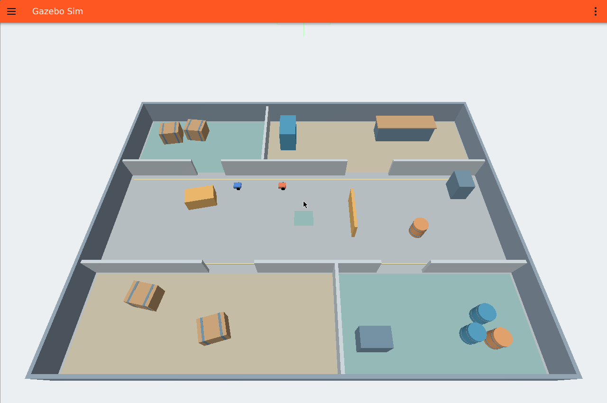

# Robotic Search and Tracking Using Q Learning in Gazebo

MSML642 Phase 1 Progress Report
Jianjiong Xiang and Linfeng Cheng
November 12 2026

## Current progress

We have a working Gazebo environment and a ROS 2 interface for our search-and-tracking project. The blue robot can move through the map, read nearby obstacles and detect the red NPC within a limited field of view. The NPC follows a fixed patrol route. We can reset both robots and run an episode from Python. The accompanying video shows the simulation running and a completed capture using the rule-based baseline.

Our project still follows the proposal. We use tabular Q-learning with four actions and local observations. The rule-based capture is an integration check. Learning a reliable search-and-tracking policy is the next part of the work.

## Simulation and programming setup

The environment runs in Docker with Ubuntu 24.04, ROS 2 Jazzy and Gazebo Harmonic. The repository includes the Dockerfile, Compose configuration and startup scripts, so a teammate can clone the project and launch the same environment. The Gazebo GUI is available in a browser through the viewer container.

We built a 16 by 12 m indoor map with a central corridor and four areas connected by doorways. Walls, partitions, crates, drums and cabinets have collision geometry. Both robots use differential drive. The learner has a 180-degree lidar with a 6 m maximum range. The NPC detector has a 4 m range and a 90-degree field of view, and uses a lidar ray to check for an obstacle blocking the target.

## What we checked

We ran 22 unit tests covering the state encoding, Q-learning updates, local geometry, recovery logic, detector, rewards and metrics. All passed. A separate Gazebo check passed for visible and hidden targets, obstacle occlusion, robot resets, moving-target capture, body contact and collision recovery.

The contact check initially exposed a mismatch between the Gazebo contact topic and the ROS bridge. We corrected the bridge and repeated the test. We also wait for updated robot poses and fresh sensor messages after a reset, rather than using messages left in the subscription queues.

The recorded rule-based run used the workshop_visit route with the NPC initially visible. It ended in capture after 83 actions and 25.64 simulation seconds, with 0 collisions. This is one setup test with a favorable starting condition. It does not measure general search performance.

## Early training and remaining work

The discrete state has 1,080 possible values and the Q-table has four actions per state. It includes target visibility, direction and distance when visible, three obstacle readings and the last observed target direction. The policy does not receive the map or the hidden target position. World poses are used only inside the sensor simulator, reset checks, reward bookkeeping and evaluation.

We completed a 12-episode Q-learning debugging run with seed 0, a 140-step limit and a start point where the NPC was visible. The Q-table updated and saved after each episode. None of these episodes ended in capture. This gives us a working training loop, but the policy still needs more training and tuning. We have implemented the proposed rewards, lost-target search and collision recovery, along with commands for random and rule-based baselines and the two reward ablations.

For Phase 2, we will train for longer, evaluate the same start points and routes across policies, and repeat the comparison with multiple seeds. We will examine capture rate, detection and capture time, collisions, rediscoveries and episode return. We will also compare runs with the exploration bonus or rediscovery bonus removed. No change to the project goal or learning method is planned.

## Code and evidence

The Phase 1 video shows a rule-based capture and an early Q-learning training segment, both recorded from the running Gazebo GUI.

https://github.com/Gjohnx/MSML642-Group-Project
